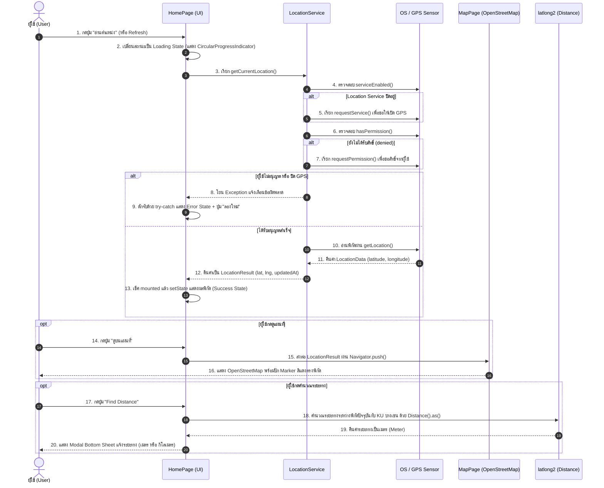
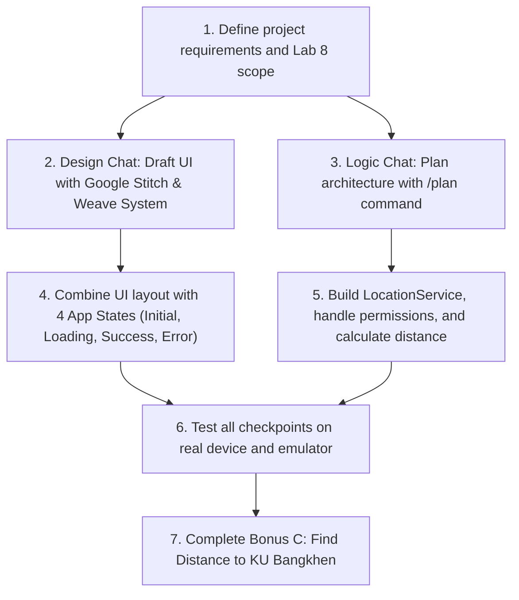

# My Location Explorer (Lab 8)

A Flutter mobile application that checks device location services, requests permissions, reads real-time GPS coordinates, displays an interactive map using **OpenStreetMap**, and calculates the distance to a reference landmark.

---

## 👤 Student Information
* **Name:** Mr. Sirasit Songpaeng
* **Student ID:** 6630300807
* **University:** Kasetsart University, Sriracha Campus
* **Course:** 03603437 - Mobile Application Development
 (Lab 8: Flutter Packages, Location Services, and OpenStreetMap)

---

## Sequence Diagram

---

## 🤖 How AI Was Used (Dual-Chat Workflow)

For this project, I used an **AI-Assisted Pair Programming** approach with two separate AI chats to keep the work organized:



### 1. Chat 1: Design & UI/UX (Design Chat)
* **UI Prototyping:** Used AI to quickly turn UI ideas from Google Stitch into clean Flutter widgets.
* **Design Consistency:** Applied the **Weave Design System** (warm canvas colors, terracotta accents, and status badges) to create a modern and easy-to-read interface.

### 2. Chat 2: Logic & Architecture (Working Chat)
* **Step-by-Step Planning:** Used the `/plan` command to design the system flow before writing code.
* **Safe Error Handling:** Implemented proper permission checks and wrapped location requests in `try-catch` blocks to prevent app crashes.
* **Feature Development (Bonus C):** Used the `latlong2` package to calculate the real-world distance between the user and Kasetsart University (Bangkhen Campus).

> **Summary:** *I worked as the project lead and reviewer—making decisions, writing core logic, and checking code quality—while AI served as a fast assistant for drafting layouts and boilerplate code.*

---

## 📦 Package Installation

Open your terminal in the project folder and run:

```bash
flutter pub get
```

### Main Packages Used (`pubspec.yaml`):
* `location: ^10.0.2` – Checks location services, requests permissions, and reads GPS coordinates.
* `flutter_map: ^8.3.2` – Displays interactive OpenStreetMap tiles without needing an API key.
* `latlong2: ^0.10.1` – Manages `LatLng` coordinates and calculates distances.
* `intl: ^0.20.3` – Formats dates, times, and numbers.

---

## 🚀 How to Run the App

Make sure your emulator is running or a physical device is connected, then run:

```bash
flutter run
```

---

## 🌟 Key Features
1. **Real-Time GPS Location:** Reads latitude, longitude, and last updated time.
2. **Four UI States:** Clear user feedback for Initial, Loading, Success, and Error states.
3. **OpenStreetMap Integration:** Shows current location with a red marker.
4. **Package Information Page:** Displays all installed packages and their purposes in a clean list.
5. **Bonus C (Find Distance):** Calculates the surface distance to Kasetsart University (Bangkhen Campus) with automatic unit conversion (meters or kilometers).

---

## 📸 Picture


